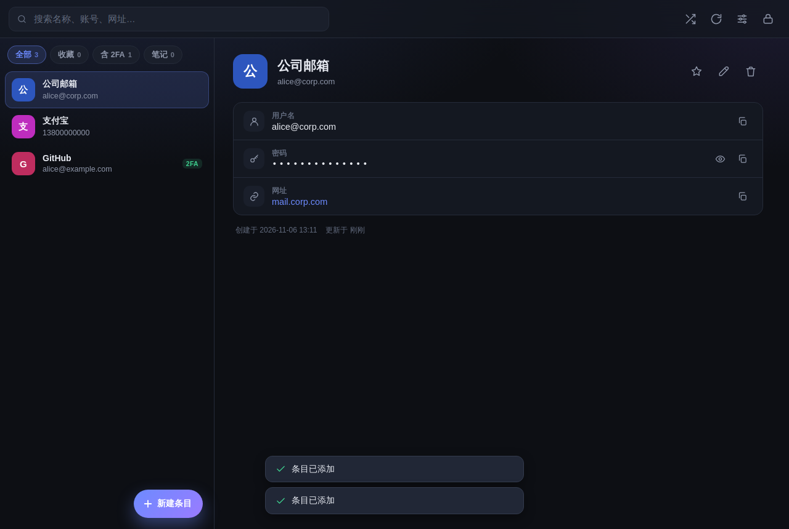
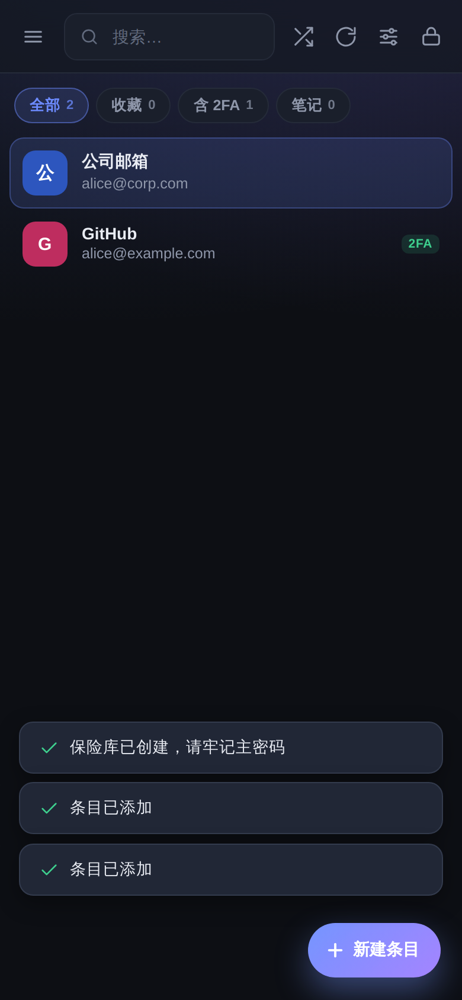
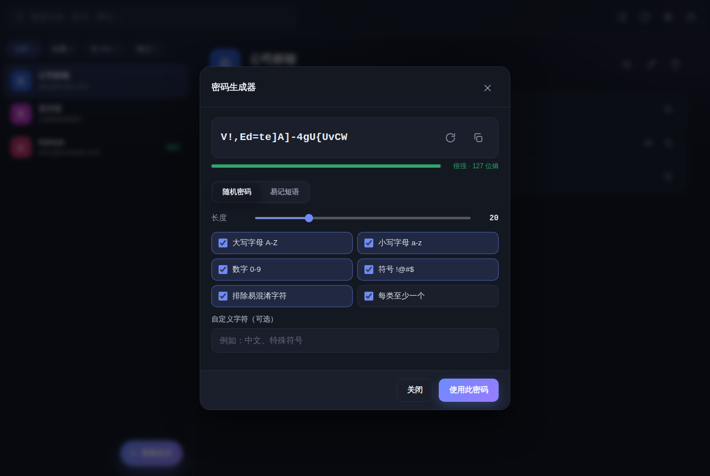
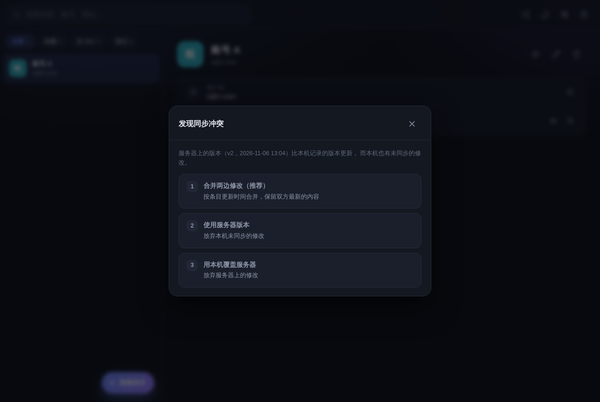
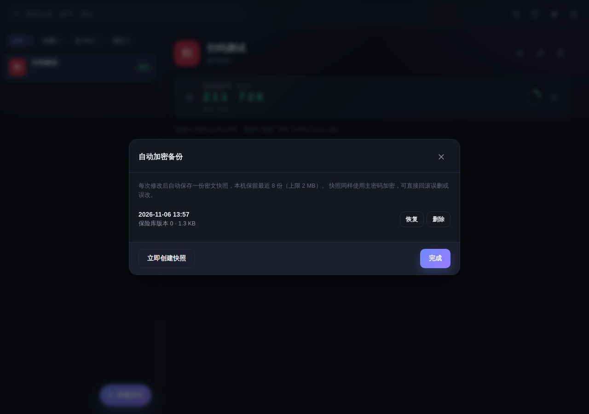

# 密码保险库 · PassVault

一个**完全本地加密**的密码管理器，Windows 与安卓都能用，支持 **2FA 动态验证码**、**自定义密码生成**、**局域网手动同步**，界面为简体中文。

> 设计上参考了 KeePassXC / KeePassDX（本地加密保险库）、Bitwarden（条目模型与 CSV 互通）、Aegis Authenticator 与 Google Authenticator（2FA 导入格式）、RFC 6238 / RFC 4226（TOTP/HOTP 算法）。

## 界面预览

| 电脑端 | 手机端 |
| --- | --- |
|  |  |

| 密码生成器 | 同步冲突处理 |
| --- | --- |
|  |  |

| 自动加密备份 | 扫码导入 2FA |
| --- | --- |
|  |  |

---


## 一、功能一览

| 需求 | 实现情况 |
| --- | --- |
| Windows 端 | 电脑运行本地服务，浏览器打开即用；可「安装为应用」变成独立窗口 |
| 安卓端 | 手机浏览器访问电脑的 HTTPS 局域网地址（自动签发证书），可「添加到主屏幕」当 App 用 |
| 导入与使用 2FA 密钥 | 支持 `otpauth://` 链接、Base32 密钥、Google Authenticator 迁移包、Aegis / andOTP 导出文件；内置 TOTP 验证码（30 秒刷新、倒计时圆环、一键复制） |
| 简体中文 | 全中文界面 |
| 账号密码保存 | 条目含名称、用户名、密码、网址、备注、标签、收藏 |
| 局域网手动同步 | 电脑端一键启动同步服务，手机填地址 + 口令，点「同步」即可；带版本冲突检测与三方合并 |
| 自定义密码生成 | 长度、大小写、数字、符号、排除易混淆字符、自定义字符、每类至少一个；另有「易记短语」模式与强度/熵显示 |

新增（v1.1）：

| 能力 | 说明 |
| --- | --- |
| 扫码导入 2FA | 摄像头实时扫码（jsQR 本地解码）或从相册选图识别，图像不出设备 |
| 自动加密备份 | 每次修改自动留一份密文快照，保留最近 8 份，可一键回滚 |
| 加密备份导入 | 从 `.json` 备份恢复，可选「合并」或「覆盖」 |
| 桌面安装包 | Electron 打包 `Setup.exe` / 免安装版 |
| 安卓安装包 | Capacitor 打包 `apk`，原生窗口 + 系统分享导出 |

额外能力：自动锁定、剪贴板定时清除、加密备份导出、CSV/JSON 导入导出、深色/浅色主题、搜索与筛选。

---

## 二、快速开始

### 方式 A：直接用安装包（推荐）

到 GitHub 仓库的 **Actions → Build → 最新一次运行** 下载产物，或到 **Releases** 下载：

| 文件 | 说明 |
| --- | --- |
| `PassVault-Setup-1.1.0.exe` | Windows 安装版（可选安装目录、创建桌面快捷方式） |
| `PassVault-Portable-1.1.0.exe` | Windows 免安装版，双击即用 |
| `app-debug.apk` | 安卓安装包（允许「安装未知来源应用」后安装） |

> 仓库里的 `dist/` 目录已附带本机构建产物：`PassVault-Windows-Portable-1.1.0.zip`（解压后双击 `PassVault.exe`）与 `PassVault-1.1.0-debug.apk`。安装包（Setup.exe）由 CI 在 Windows 上生成。

安装完成后：Windows 双击图标即可；安卓打开 App 后先在「设置 → 局域网同步」填电脑的地址与口令。

### 方式 B：源码运行（Windows）

1. 安装 [Node.js](https://nodejs.org/zh-cn) 18 或更高版本（一路「下一步」即可）。
2. 双击 `scripts/start-windows.bat`。
3. 浏览器会自动打开 `http://127.0.0.1:8787`，首次使用设置主密码 → 创建保险库。
4. 想让它像个独立软件？在 Edge / Chrome 地址栏右侧点「安装」图标，即可固定到任务栏、独立窗口运行。

> 也可以手动启动：在项目目录执行 `node server/server.js`。

### 2. 安卓端

1. 手机与电脑连接**同一个 Wi-Fi**。
2. 电脑上启动服务后，控制台会打印类似：
   ```
   局域网：  http://192.168.1.10:8787   (WLAN)

   📱 手机请使用下面的 HTTPS 地址：
      https://192.168.1.10:8443

   同步口令：7K3M-9QXA-2W8D-5RTY
   ```
3. 手机浏览器打开 **`https://192.168.1.10:8443`**（注意是 https 和 8443 端口）。
   首次会提示「您的连接不是私密连接」——点「高级」→「继续前往」即可（证书是电脑自动生成的，只用于局域网加密）。
4. 首次使用：设置主密码创建保险库；如果电脑上已有数据，进入「设置 → 局域网同步」填写地址和口令，点「立即同步」把数据拉下来。
5. 浏览器菜单 →「添加到主屏幕」，之后从桌面图标进入。

> **为什么必须用 HTTPS？** 浏览器只在 HTTPS 或 localhost 下开放 WebCrypto 加密接口。用 `http://` 局域网地址打开时，页面会显示「需要安全连接」的提示并给出正确的 HTTPS 链接。

### 3. 局域网同步怎么用

- **电脑**：启动服务 → 记下控制台显示的「局域网地址」和「同步口令」。
- **手机**：设置 → 局域网同步 → 填地址与口令 →「测试连接」→「立即同步」。
- 之后每次改完数据，点右上角的 ⟳ 按钮即可手动同步。
- 服务端只保存**密文**，没有主密码谁也解不开；口令只用于防止局域网内其他人乱连。

同步规则：

| 情况 | 行为 |
| --- | --- |
| 服务器为空 | 把本机保险库上传 |
| 版本一致、本机有改动 | 上传覆盖 |
| 版本一致、本机无改动 | 提示「已是最新版本」 |
| 服务器更新、本机无改动 | 自动拉取 |
| 两边都有改动 | 弹窗让你选择：**合并（推荐）/ 用服务器覆盖 / 用本机覆盖** |

合并按「条目 id + 更新时间」逐条取新，删除操作以墓碑形式参与比较，不会把已删条目又合并回来。

---

## 三、使用说明

### 2FA 动态验证码

- 新建/编辑条目时，在「2FA 密钥」里粘贴：
  - `otpauth://totp/GitHub:me@example.com?secret=JBSWY3DPEHPK3PXP&issuer=GitHub`
  - 或直接粘贴 Base32 密钥（如 `JBSWY3DPEHPK3PXP`）
  - 也可以点输入框右侧的 📷 图标**直接扫码**：摄像头实时识别，或从相册选一张二维码图片。解码全部在本机完成（jsQR），图片不会上传。
- 保存后条目详情页会显示 6/8 位验证码、倒计时圆环，点复制按钮即可。
- 支持 SHA1 / SHA256 / SHA512、6/8 位、自定义周期。

**批量导入 2FA**（设置 → 导入 → 粘贴文本）：

- Google Authenticator：在 App 里「转移账号 → 导出账号」，把生成的 `otpauth-migration://offline?data=...` 链接整段粘贴进来。
- Aegis：导出「明文 JSON」后选择文件导入。
- andOTP：导出 JSON 后导入。
- 纯文本：每行 `发行方,账号,密钥` 或只写密钥。

### 密码生成器

右上角 🎲 按钮打开：

- **随机密码**：长度 6–64，可勾选大写/小写/数字/符号、排除 `0O1lI|` 等易混淆字符、追加自定义字符、保证每类至少一个。
- **易记短语**：3–8 个单词，可选分隔符、首字母大写、末尾加数字。
- 实时显示强度与熵值（比特）。
- 在编辑条目时点密码框右侧的 🎲，生成后可直接填入。

### 备份与恢复

- **自动加密备份**：每次修改后自动留一份密文快照，本机保留最近 8 份（上限 2 MB）。在「设置 → 自动加密备份」里可以查看、恢复、删除，或手动补一份快照。误删条目、误覆盖后点「恢复」即可回滚，恢复时可选合并或覆盖。
- **导出加密备份**：设置 → 导出加密备份，得到 `.json` 文件。它仍然是加密的，换设备后需要主密码才能打开。
- **导入加密备份**：设置 → 导入加密备份，选文件 → 输入该备份的主密码（若与当前相同则自动解密）→ 选择合并或覆盖。
- **服务端备份**：电脑端每次同步前会把上一版密文存到 `data/backups/`，保留最近 20 份。

> 安卓 App 里导出文件会调起系统分享面板，可以存到「文件」、微信或网盘；浏览器里则是普通下载。

### 导入 / 导出

- **导入**：本应用 JSON、Bitwarden / Chrome / KeePass / 1Password 的 CSV、Aegis / andOTP JSON、2FA 文本。导入时按「名称 + 用户名」自动跳过重复项。
- **导出**：
  - 加密备份 `.json`（推荐，需主密码才能打开）
  - 明文 CSV（Bitwarden 兼容）
  - 明文 JSON
  - 2FA 链接列表（`otpauth://`，可导入其他验证器）

### 安全设置

- **自动锁定**：1/5/15/30/60 分钟或永不，无操作后自动锁定并清空内存中的密钥。
- **剪贴板自动清除**：复制密码后 15/30/60 秒清空剪贴板。
- **修改主密码**：用新密码重新加密整个保险库（PBKDF2 重新派生 + 新盐）。

---

## 四、安全设计

| 项目 | 方案 |
| --- | --- |
| 密钥派生 | PBKDF2-SHA256，600,000 次迭代，16 字节随机盐 |
| 加密 | AES-256-GCM，96 位随机 IV，128 位认证标签 |
| 完整性 | 版本号、更新时间、设备 ID 作为 AAD 参与认证，篡改即解密失败 |
| 存储 | 浏览器 IndexedDB/localStorage 中只存密文；服务端只存密文 |
| 传输 | 局域网 HTTP（可选 HTTPS），口令鉴权 + 失败限流 |
| 2FA | RFC 6238 TOTP / RFC 4226 HOTP，密钥只存在加密保险库内 |
| 随机数 | `crypto.getRandomValues`（CSPRNG），生成器使用拒绝采样避免模偏差 |

**威胁模型**：能防住「设备丢失、文件被拷走、局域网内他人访问同步服务」。**防不住**：设备已被植入键盘记录器/木马、主密码过于简单被暴力破解、你自己把明文导出后泄露。

建议：

1. 主密码至少 12 位，用一句只有你记得的话。
2. 定期导出加密备份，放到 U 盘或另一台设备。
3. 不要在主密码里复用其他网站密码。
4. 公共 Wi-Fi 下不要开启同步服务。

---

## 五、自己打包 exe / apk

三条命令即可，全部产出在 `dist/`：

```bash
npm install
npm run dist:win      # Windows：NSIS 安装包 + 免安装版（在 Windows 上执行，或交给 CI）
npm run pack:win      # 仅免安装目录（可在 Linux/macOS 上交叉打包）
npm run android:build # 安卓：android/app/build/outputs/apk/debug/app-debug.apk
```

安卓打包需要 JDK 17 + Android SDK 34：

```bash
export ANDROID_HOME=$HOME/android-sdk
npx cap sync android
cd android && ./gradlew assembleDebug
```

### 一键交给 GitHub Actions

仓库已内置 `.github/workflows/build.yml`：

1. 把项目推到 GitHub（`git init && git add . && git commit -m "init" && git push`）。
2. 打开 **Actions → Build → Run workflow**，或直接 push 到 `main`。
3. 跑完后在本次运行页面底部下载 `PassVault-Windows`（两个 exe）和 `PassVault-Android`（apk）两个 artifact。
4. 打标签发版：`git tag v1.1.0 && git push origin v1.1.0`，会自动创建 Release 并附上 exe 与 apk。

CI 里做了什么：

| Job | 内容 |
| --- | --- |
| `test` | `npm test`（27 个单元/集成测试） |
| `windows` | windows-latest + electron-builder → `Setup.exe`、`Portable.exe` |
| `android` | ubuntu + JDK 17 + Android SDK 34 + Gradle → `app-debug.apk` |
| `release` | 打 tag 时自动发布 Release |

### 结构说明

```
desktop/main.mjs     Electron 主进程：启动内嵌服务 + 原生窗口 + 中文菜单
server/app.js        可嵌入的服务核心（Class PassVaultServer）
server/server.js     CLI 入口（Node 直接运行）
android/             Capacitor 生成的安卓工程（已加相机权限）
capacitor.config.json  appId / webDir / https scheme
build/icon.ico       应用图标
```

## 六、关于 HTTPS 与证书

服务启动时会**同时**监听两个端口：

| 端口 | 协议 | 用途 |
| --- | --- | --- |
| 8787 | HTTP | 电脑本机使用（`http://127.0.0.1:8787`，localhost 属于安全上下文，无需证书） |
| 8443 | HTTPS | 手机 / 其他设备使用（`https://192.168.x.x:8443`） |

HTTPS 证书在首次启动时由 `server/cert.js` **自动生成**（ECDSA P-256 自签名，包含本机所有局域网 IP），保存在 `data/cert.pem` 与 `data/key.pem`，不需要安装 openssl。

- 浏览器提示证书不受信任是正常的（自签名），点「高级 → 继续前往」即可。
- 想用自己的证书：`node server/server.js --cert 证书.pem --key 私钥.pem`。
- 不需要 HTTPS：`node server/server.js --no-https`。
- 换网络后 IP 变了：删除 `data/cert.pem` 与 `data/key.pem` 重启，会按新 IP 重新生成。

> 自签名证书能防止局域网内的被动窃听，但无法防止主动中间人攻击。家庭 / 办公内网足够；公共 Wi-Fi 请勿使用。

---

## 七、目录结构

```
password-manager/
├── desktop/
│   └── main.mjs           # Electron 主进程（内嵌服务 + 原生窗口 + 中文菜单）
├── server/
│   ├── app.js             # 可嵌入的服务核心（PassVaultServer 类）
│   ├── server.js          # CLI 入口
│   └── cert.js            # 自动生成自签名 HTTPS 证书
├── web/
│   ├── index.html         # 界面骨架
│   ├── styles.css         # 样式（深色/浅色、响应式）
│   ├── manifest.webmanifest
│   ├── sw.js              # Service Worker（离线缓存）
│   ├── icons/             # 应用图标
│   ├── vendor/jsQR.js     # 二维码解码（MIT）
│   └── js/
│       ├── app.js         # 界面逻辑与同步流程
│       ├── crypto.js      # PBKDF2 + AES-GCM 保险库
│       ├── totp.js        # TOTP/HOTP 与 otpauth 解析
│       ├── migration.js   # Google Authenticator / Aegis 导入
│       ├── qrscan.js      # 摄像头 / 相册扫码
│       ├── backup.js      # 自动加密快照
│       ├── generator.js   # 密码与短语生成
│       ├── vault.js       # 条目模型、合并、CSV/JSON
│       ├── sync.js        # 同步客户端
│       ├── base32.js
│       └── util.js
├── android/               # Capacitor 安卓工程（含相机权限）
├── build/                 # 打包图标
├── .github/workflows/     # GitHub Actions：测试 + exe + apk + Release
├── capacitor.config.json
├── scripts/               # 各平台启动脚本、证书脚本
├── tests/                 # 单元/集成测试
└── data/                  # 运行时数据（密文、口令、备份）
```

---

## 八、开发与测试

```bash
npm test          # 27 个测试：加密、TOTP RFC 向量、迁移包解析、合并、CSV、生成器、快照、服务端 API
npm run desktop   # 以 Electron 桌面应用方式启动
npm start         # 启动服务（默认 8787 端口）
node server/server.js --port 9000 --data ./mydata --token 自定义口令
```

服务端参数：

```
-p, --port <端口>       HTTP 端口（默认 8787）
    --https-port <端口> HTTPS 端口（默认 8443）
    --no-https          不启动 HTTPS
    --host <地址>       监听地址（默认 0.0.0.0）
    --data <目录>       数据目录（默认 ./data）
    --token <口令>      指定同步口令
    --no-auth           关闭口令校验（不推荐）
    --cert / --key      使用自定义证书
```

数据文件：

- `data/vault.json`：加密后的保险库（服务端唯一保存的内容）
- `data/token.txt`：同步口令
- `data/backups/`：每次同步前的自动备份（保留最近 20 份）

---

## 九、常见问题

**Q：忘记主密码怎么办？**
A：无法找回——这是加密的必然结果。可以用之前导出的加密备份 + 记得的密码恢复；如果备份也没有，只能清空重建。

**Q：手机连不上电脑？**
A：① 确认同一 Wi-Fi；② Windows 防火墙首次会弹窗，选择「允许访问」；③ 确认地址里的 IP 是电脑的局域网 IP（控制台会打印）；④ 部分路由器开启了「AP 隔离」，需要关闭；⑤ 手机要用 `https://IP:8443`，不是 8787。

**Q：手机打开显示「需要安全连接」？**
A：说明用的是 HTTP 地址。改用控制台打印的 `https://IP:8443`，并在证书警告页点「高级 → 继续前往」。

**Q：同步时提示「主密码不同」？**
A：说明服务器上的保险库是用另一个主密码创建的。输入那个主密码即可解密并合并。

**Q：数据存在哪里？会上传云端吗？**
A：只存在你的浏览器本地和你的电脑上，没有任何云端服务器，代码里也没有任何外发请求。

**Q：能用摄像头扫 2FA 二维码吗？**
A：当前版本通过「粘贴 otpauth:// 链接 / Base32 密钥」或文件导入，暂未内置摄像头扫码。多数验证器（Google Authenticator、Aegis）都支持导出迁移包或显示密钥文本，直接粘贴即可。

**Q：换网络后手机提示证书错误 / 打不开？**
A：IP 变了导致证书里的地址不匹配。删除 `data/cert.pem` 与 `data/key.pem`（或运行 `bash scripts/reset-cert.sh`），重启服务会按新 IP 重新生成。

**Q：能不能自动填充网页密码？**
A：当前版本不含浏览器扩展/自动填充，定位是「本地保险库 + 手动复制」。需要自动填充可以配合 KeePassXC 浏览器插件使用同一份导出数据。

---

## 十、开源参考

- [KeePassXC](https://github.com/keepassxreboot/keepassxc) — 本地加密保险库的交互与安全实践
- [KeePassDX](https://github.com/Kunzisoft/KeePassDX) — 安卓端体验参考
- [Bitwarden](https://github.com/bitwarden/clients) — 条目模型与 CSV 字段规范
- [Aegis Authenticator](https://github.com/beemdevelopment/Aegis) — 2FA 导出格式
- [RFC 6238](https://datatracker.ietf.org/doc/html/rfc6238) / [RFC 4226](https://datatracker.ietf.org/doc/html/rfc4226) — TOTP / HOTP
- [OWASP Password Storage Cheat Sheet](https://cheatsheetseries.owasp.org/cheatsheets/Password_Storage_Cheat_Sheet.html) — KDF 参数

本项目为独立实现，未复制上述项目的代码。

---

MIT License
